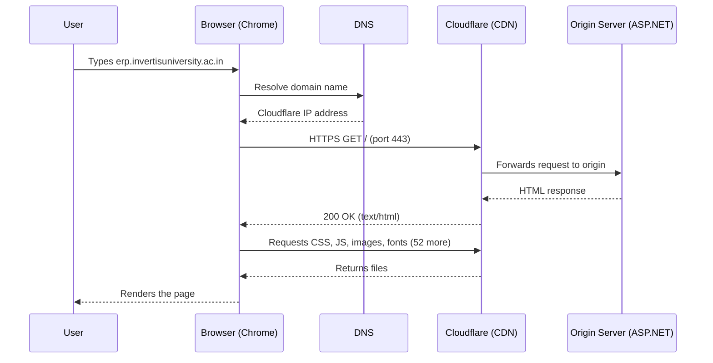
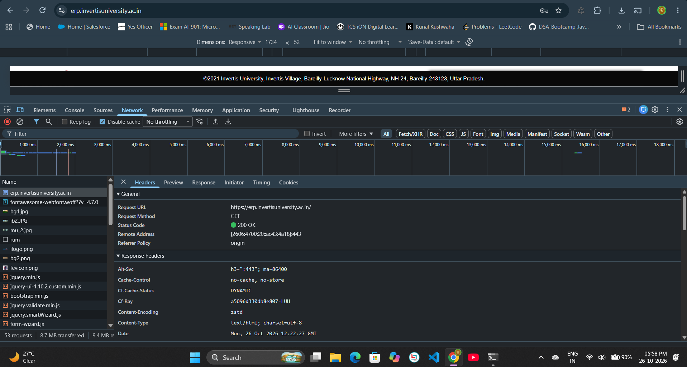
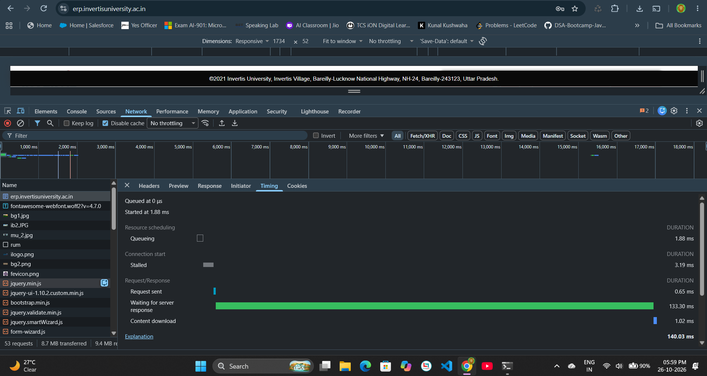

# Practical 1.1 - Web Application Architecture

## Website traced
URL: https://erp.invertisuniversity.ac.in/

## Request details (Chrome DevTools - Network tab)
| Field | Value |
|---|---|
| Request Method | GET |
| Status Code | 200 OK |
| Remote Address | [2606:4700:20::ac43:4a18]:443 (Cloudflare, IPv6) |
| Content-Type | text/html; charset=utf-8 |
| Content-Encoding | zstd |
| Server | cloudflare |
| X-Powered-By | ASP.NET |
| Cache-Control | no-cache, no-store |
| Total requests | 53 |
| Data transferred | 8.7 MB |

Note: Device toolbar was ON, so the User-Agent shows a mobile Android browser.

## Timing of the main document request
| Phase | Time |
|---|---|
| Queueing | 1.88 ms |
| Stalled | 3.19 ms |
| Request sent | 0.65 ms |
| Waiting for server response | 133.30 ms |
| Content download | 1.02 ms |
| **Total** | **140.03 ms** |

Server-Timing: cfEdge 2 ms, cfOrigin 43 ms.

## Browser-Server Flow

## Screenshots

