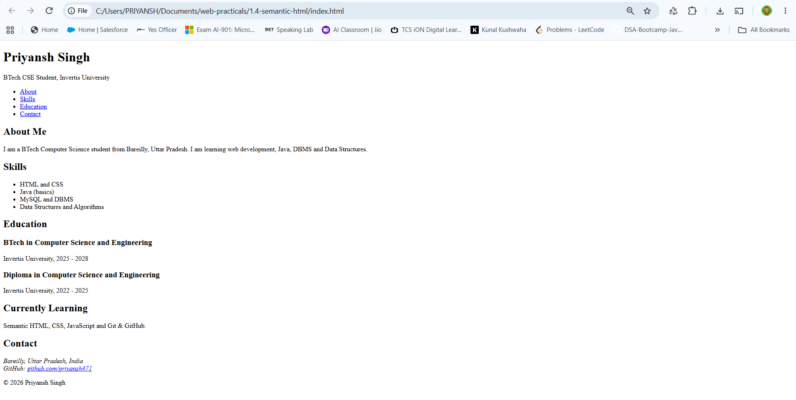

# Practical 1.4 - Semantic HTML Document Structure

## 1. Title
Semantic HTML Document Structure

## 2. Aim
To build the semantic skeleton of a personal profile page using semantic HTML5 elements.

## 3. Tools Used
- Notepad / VS Code (text editor)
- Google Chrome (browser)
- Git and GitHub (to upload the practical)

## 4. Theory
Semantic HTML means using tags that describe the meaning of the content, not just how it looks. A tag like `<header>` tells both the browser and the developer that the content inside is the top part of the page. A tag like `
` tells nothing about its content.

Benefits of semantic HTML:
- Code is easier to read and maintain.
- Screen readers can understand the page, so it is more accessible.
- Search engines understand the page better (SEO).

Semantic elements used in this practical:

| Tag | Purpose |
|---|---|
| `<header>` | Top part of the page: name, title and navigation |
| `<nav>` | Group of navigation links |
| `<main>` | Main content of the page (only one per page) |
| `<section>` | A themed group of content, such as About or Skills |
| `<article>` | A self-contained item, such as one education entry |
| `<aside>` | Extra, side information |
| `<footer>` | Bottom part of the page: contact and copyright |
| `<address>` | Contact information |

## 5. Procedure
1. Create a folder named `1.4-semantic-html` inside the `web-practicals` folder.
2. Create a file named `index.html` inside it.
3. Write the basic HTML structure: `<!DOCTYPE html>`, `<html lang="en">`, `<head>` and `<body>`.
4. Add a `<header>` with the name, a short line and a `<nav>` with links.
5. Add a `<main>` containing the About, Skills and Education sections, and an `<aside>`.
6. Add a `<footer>` with the contact details inside an `<address>` tag.
7. Open `index.html` in Chrome and check the page.
8. Take a screenshot and save it as `output.png`.
9. Upload the folder to GitHub using `git add .`, `git commit` and `git push`.

## 6. Code
The code is kept in a separate file: [index.html](index.html)

## 7. Input
No user input is required. This is a static HTML page.

## 8. Output

## 9. Result
A personal profile page was created using semantic HTML elements: header, nav, main, section, article, aside, footer and address. The page structure is clear and meaningful.

## 10. Viva Questions
1. What is semantic HTML?
2. What is the difference between `
` and `<section>`?
3. Why should a page have only one `<main>` element?
4. What is the use of the `<nav>` tag?
5. How does semantic HTML help accessibility and SEO?
