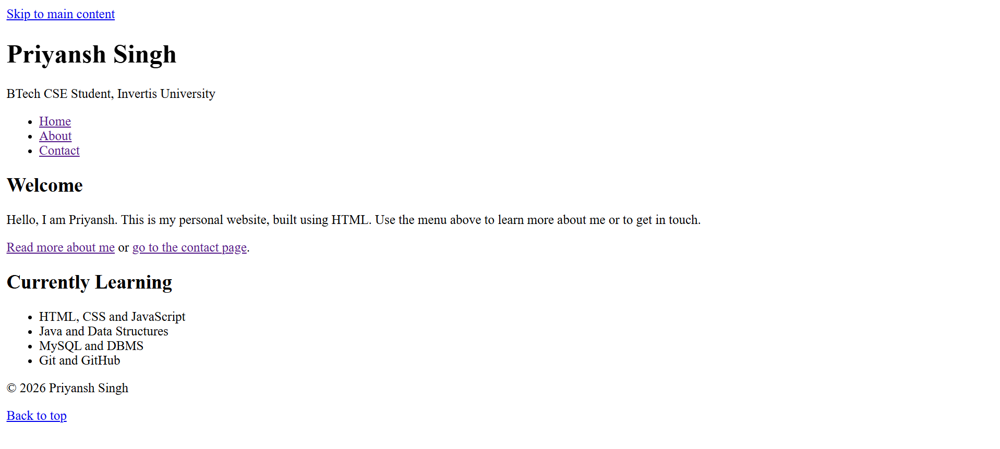

# Practical 2.1 - Links, Navigation & Multi-page Architecture

## 1. Title
Links, Navigation and Multi-page Architecture

## 2. Aim
To create linked Home, About and Contact pages with a common navigation menu.

## 3. Tools Used
- VS Code (text editor)
- Google Chrome (browser)
- Live Server extension
- Git and GitHub (to upload the practical)

## 4. Theory
A website usually has more than one page. Pages are connected with hyperlinks using the anchor tag `<a>`. The `href` attribute holds the address of the page to open.

Types of links:

| Type | Example | Use |
|---|---|---|
| Relative link | `<a href="about.html">` | Link to another page in the same website |
| Absolute link | `<a href="https://github.com/...">` | Link to another website |
| Anchor (fragment) link | `<a href="#main-content">` | Jump to a part of the same page |

Important points:
- `<nav>` groups the main navigation links, and the same menu is repeated on every page.
- `aria-current="page"` marks the link of the page the user is currently on.
- `target="_blank"` opens a link in a new tab. It should be used with `rel="noopener noreferrer"` for safety.
- Link text should be descriptive, for example "Read more about me" instead of "click here".
- All pages are kept in the same folder, so relative links such as `about.html` work correctly.

## 5. Procedure
1. Create a folder named `2.1-multi-page-navigation` inside `web-practicals`.
2. Create three files in it: `index.html` (Home), `about.html` and `contact.html`.
3. Write the same header and `<nav>` menu on all three pages.
4. Add `aria-current="page"` to the menu link of the current page.
5. Add content to each page, with links to the other pages inside the content.
6. Add an external link to GitHub that opens in a new tab.
7. Add a "Back to top" link and a "Back to Home" link in the footers.
8. Open `index.html` with Live Server and click every link to test it.
9. Take screenshots of the pages and save them as `output-home.png`, `output-about.png` and `output-contact.png`.
10. Upload the folder to GitHub using `git add .`, `git commit` and `git push`.

## 6. Code
The code is kept in separate files:
- [index.html](index.html) (Home)
- [about.html](about.html) (About)
- [contact.html](contact.html) (Contact)

## 7. Input
No user input is required. The user clicks the links to move between pages.

## 8. Output
Home page:

About page:

Contact page:

## 9. Result
A multi-page website with Home, About and Contact pages was created. All pages are connected with a common navigation menu, and internal, external and anchor links work correctly.

## 10. Viva Questions
1. What is the use of the `<a>` tag and the `href` attribute?
2. What is the difference between a relative and an absolute link?
3. What does `target="_blank"` do, and why is `rel="noopener noreferrer"` used with it?
4. What is an anchor (fragment) link?
5. Why is `aria-current="page"` used in a navigation menu?
